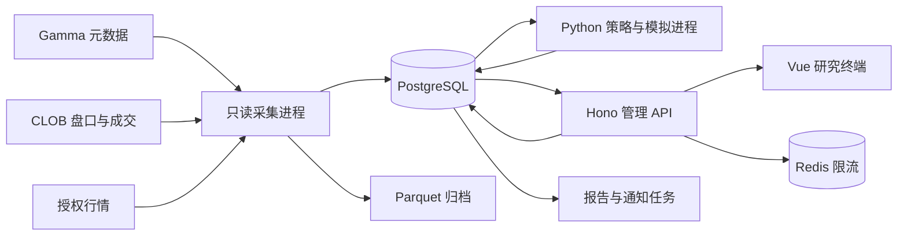

# 系统架构

接收时间、来源时间和提交顺序分别建模。进程重启后先恢复持久状态；缺口跨越的报价不能产生历史补成交。仓库采用少量可部署进程，将策略、回测、撮合和风险作为 Python 模块共享。API 从固定关系清单提供只读分页，写入端依业务动作验证，身份和审计附于每个管理员命令。浏览器通过会话和 SSE 接收变更提示。

管理面的断线不影响采集；数据源的断线必须影响依赖该源的研究准入。PostgreSQL 是控制状态、事件索引和账本的权威来源。Redis 仅保存可重建短期状态。Parquet 分片由事件范围标识。独立账户在同一行情上运行属于反事实对照实验。
